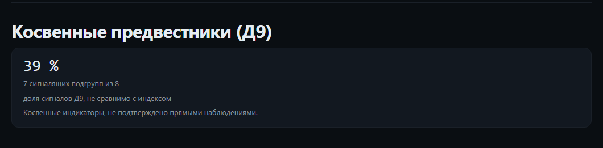
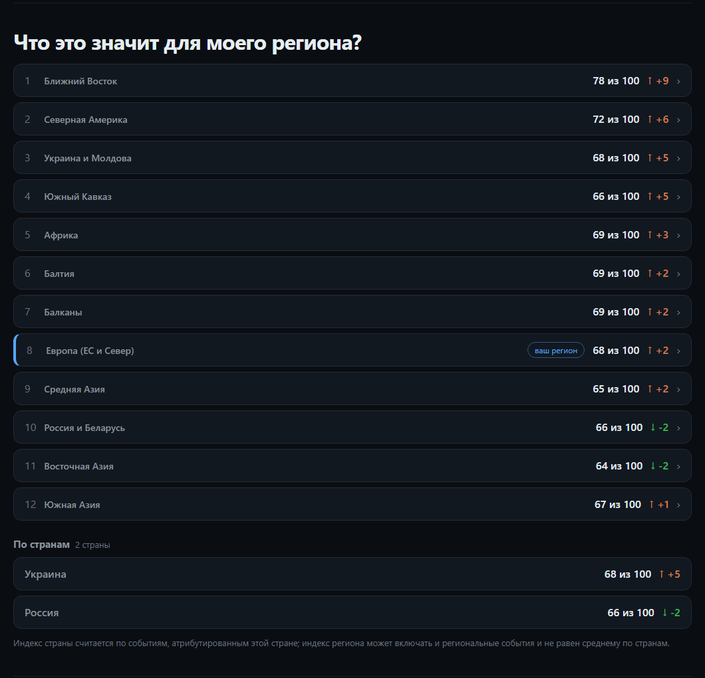
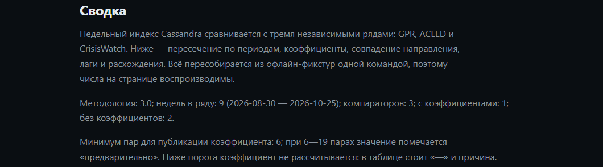
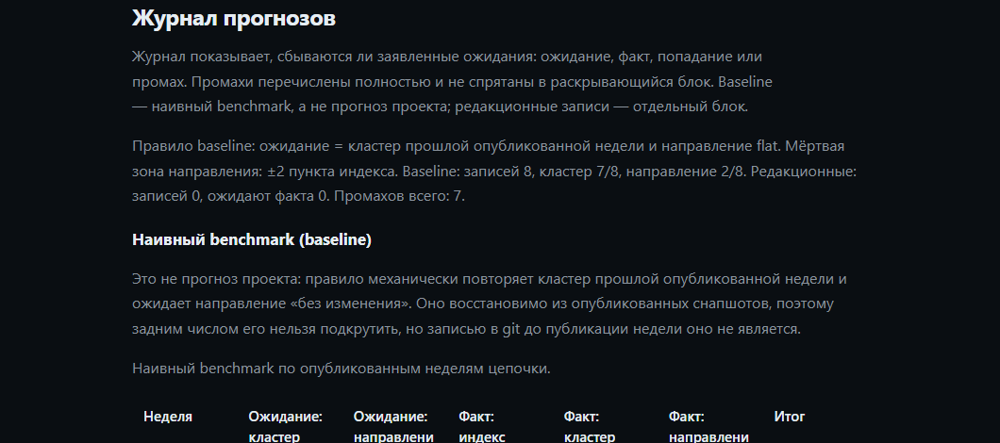

# 46 критериев, 12 регионов и сверка снаружи: как устроен открытый еженедельный индекс риска глобального конфликта

Привет, Хабр!

Мы тонем в новостях. Голова кругом: тут говорят одно, там - противоположное, а где правда - непонятно.

Информации не мало - её слишком много. Не хватает инструмента, который показывал бы, как риск меняется **во времени**: по открытым данным, а не по громкости заголовка.

Такого инструмента я не нашёл. Пришлось собрать самому.

Получился **Индекс Кассандры** - еженедельный сервис про уровень и направление риска глобального конфликта. Без регистрации, трекеров и подписок. Код, методика, данные и тесты открыты на GitHub, сайт статический (GitHub Pages).

Свежая неделя (25 октября 2026): **68 из 100, +4** к предыдущей (64). Девять недель подряд считаются одной версией методики (3.0), и это первая неделя со страновым срезом: Украина и Россия.

Ниже - как получается число, откуда берутся сигналы и что показала проверка снаружи. Проверка вышла неудобной: с внешними рядами индекс сошёлся хуже, чем хотелось бы, а направление следующей недели угадывается плохо - два раза из восьми. Об этом отдельный раздел, с числами и без смягчений.

*Главная: мировой индекс и региональный контекст - то, что видит человек, который открыл сайт и растерялся.*

## Почему Кассандра

Кассандра получила дар предвидения - и проклятие: ей никто не верил. Она предупреждала о падении Трои и о троянском коне, но её не слушали. Ошибалась она? Нет. Просто у правды не было доказательств.

Этот проект - про то же самое. Вместо «поверьте мне» здесь сигналы, ссылки на источники и формула, по которой из них получается число. Предупреждение можно проверить.

Поэтому индекс и назван в её честь. Знать мало - надо ещё показать, откуда ты это знаешь.

## Про ИИ в этом проекте

Да, без ИИ не обошлось: модель помогала писать код, а сейчас классифицирует источники - об этом раздел ниже. Критерии, агрегация, обработка нехватки данных, калибровка параметра на исторических якорях и ворота целостности - решения человеческие. Числа ниже я сверил со снапшотами, утверждения - с источниками; ответственность за текст на мне.

Тест простой: откройте сайт. Если картина понятна человеку без технического бэкграунда - инструмент справляется.

## Что отдаёт сервис

Раз в неделю - четыре вещи:

- **уровень риска** - число;
- **направление** - вверх, вниз или без изменений;
- **состояние** - читаемое, без метафор «на грани»;
- **источники** - ссылки на то, откуда взяты сигналы.

Плюс тренд по неделям, региональные разрезы, страновой срез, слой косвенных предвестников и разбор «почему индекс изменился»: вклады девяти драйверов в пунктах, откуда взялся остаток, что сдвинуло бы оценку.

И блок качества данных: сколько критериев неделя реально покрыла, насколько ей можно доверять и на сколько пунктов индекс устойчив к смене источников. Для 25 октября - покрыто 9 из 9 драйверов и **39 из 46 критериев**, вход собрал **129 записей источников** в пяти кластерах, чувствительность - 1,1 пункта (порог публичной пометки - 5).

*Тренд показывает только точки методологии 3.0 - версии не смешиваются на одной оси. По оси X - даты расчёта индекса.*

## Что внутри: 9 драйверов, 46 критериев

Риск складывается из **9 драйверов**. В сумме они опираются на **46 критериев**. Каждый критерий - сигнал своего типа: военный, экономический, дипломатический, внутренний.

Что фиксируется по критерию за неделю? Значение. Покрыт ли он источниками. Ссылки.

*Полный перечень: 46 критериев, сгруппированных по 9 драйверам. Число справа - сколько критериев в драйвере (в сумме 46).*

*Тот же перечень можно раскрыть до уровня критерия - что именно наблюдает модель по каждому сигналу.*

Оценка драйвера считается отдельно. Дальше результаты агрегируются по открытой методике. Никакого машинного обучения и «умных предсказаний» - детерминированный движок на чистых функциях.

*Разбор недели: «что изменилось», «почему это важно», вклад и уверенность, ссылки на источники - у каждого утверждения.*

## Что изменилось в расчёте с прошлой версии статьи

- **методология 3.0 и пересчитываемая цепочка.** Демо-недели ушли в архив, который не пересчитывается. Зато сплошным пересчётом считается вся цепочка - сейчас девять недель подряд (с 30 августа), от 51 до 68. Историю можно воспроизвести с начала;
- **параметр `k = 1.95`.** Больше не «на глаз»: калибровка на 10 якорных профилях (7 отборочных + 3 проверочных), проверка на устойчивость к изменению ±20 %. Весь след - в журнале;
- **классификация публикации по покрытию.** Мало данных - неделя не уезжает в молчаливый «средний» индекс, а получает состояние `insufficient`/`reduced` с причиной. Пороги - в `calc/params.js`, код - в `calc/calc.js`;
- **`through` = дата самой недели.** Окно сигналов - W−7…W включительно;
- **региональная атрибуция и слепые регионы.** Критерий может нести привязку к регионам. Регион с сигналами считается по ним; регион без сигналов сохраняет последнее отклонение от глобального фона, а сайт помечает его как фон («индекс отражает глобальный фон»), а не выдаёт глобальную дельту за региональную;
- **тренд - только по версии 3.0.** Точки более ранней серии на график не попадают.

Отдельно про рыночный критерий: в методологии 3.0 появился 46-й критерий - стресс рынков (сырьевые биржи и рынки облигаций реагируют раньше остальных сигналов). Он ломает сопоставимость серии, поэтому принят не задним числом, а новой версией методики - с перекалибровкой `k` на десяти якорях (включая новый критерий) и версионным разрывом на тренде. Сайт работает на 46 критериях.

## Регионы, страны и предвестники: три слоя поверх индекса

До 18 октября регионов было шесть - широкие блоки вроде «Европа» и «Африка». С 18 октября работает таксономия **v2 - двенадцать регионов**: Ближний Восток, Северная Америка, Украина и Молдова, Южный Кавказ, Африка, Балтия, Балканы, Европа (ЕС и Север), Средняя Азия, Россия и Беларусь, Восточная Азия, Южная Азия.

Версия таксономии версионируется отдельно от методики и не переписывает историю: недели до 18 октября навсегда остаются шестирегионными, первая двенадцатирегионная - 18 октября. Числа регионов разных версий рядом не читаются, сайт показывает набор версии просматриваемой недели.

Для 25 октября все двенадцать регионов посчитаны по своим сигналам, без единого «фона»: Ближний Восток 78 (+9), Северная Америка 72 (+6), Украина и Молдова 68 (+5), Балтия и Балканы по 69 (+2), Россия и Беларусь 66 (−2).

**Страновой слой** появился 25 октября и пока закрывает две страны из 152 возможных: Украина - 68 (+5) по 7 сигналам, Россия - 66 (−2) по 8. Считается он той же формулой, что и регион, но с отдельной редакционной атрибуцией: каждое событие привязано к стране и к источнику, основание опубликовано вместе с числом. Плюс машинный инвариант - **регион всегда видит все сигналы своих стран** («регион ⊇ страна»). Поэтому пересчёт недели меняет и региональные числа: это не баг, а условие честности.

Слой **косвенных предвестников (Д9)** публикуется отдельно и в индекс не входит. Для 25 октября - 39 из 100, сигналят 7 подгрупп из 8. Это доля сигналов, а не вероятность: шкала объявлена порядковой, сравнивать её с индексом нельзя, и ноль тут означает «сигналов нет», а не «риска нет».

*Предвестники Д9 живут отдельной строкой: доля сигналов, число подгрупп и прямая оговорка, что с индексом это не сравнивается.*

*Региональная витрина недели 25 октября: двенадцать регионов по своим сигналам и блок «По странам» с двумя государствами.*

## Источники: вход вырос в 2,4 раза, и это было главное узкое место

Три недели назад у входа было 27 покрытых критериев. Сегодня - 39. Разница не в методике, а в сборе:

- 4 октября - 54 записи источников, 27 из 46 критериев;
- 11 октября - 85 записей, всё ещё 27: источников больше, а слепых мест не убавилось;
- 18 октября - 90 записей, 34 из 46. Два прохода дозабора по реестру долга: сначала 27 → 28, потом 34. Индекс вырос с 63 до 64, полнота `q` - с 0,862 до 1,000;
- 25 октября - 129 записей, 39 из 46.

У слепоты теперь есть учёт: во входе недели по каждому непокрытому критерию стоит причина (`not-collected` / `searched-none` / `gate-failed`) и список отбракованных ссылок с датой и основанием, а дозабор ведётся по реестру долга. С 25 октября причина обязательна: нельзя просто оставить критерий пустым и забыть. Семь слепых критериев этой недели (D1.3, D1.6, D2.4, D4.1, D5.3, D5.4, D6.4) названы поимённо вместе с причиной.

Про состав входа честно. Из 129 записей: 62 в кластере независимых СМИ (A), 61 - государственные и государственно финансируемые (B), 2 - реестры (C), 1 - полевая OSINT (E), 3 - финансовые (F). Первичных источников два, OSINT - два, остальное - вторичные сообщения. Такой перекос нормален для недельного окна: первичка публикуется с задержкой. Именно поэтому ворота независимости требуют не «много источников», а **два разных кластера на критерий** (или один первичный/OSINT): двадцать перепечаток одного агентства независимости не создают.

Это ответ на частый упрёк к такому индексу: «источники выбираешь ты, значит, нарисовать можно что угодно». Теперь у критерия не может быть одного рупора, а субъективность выбора измеряется числом - метрикой чувствительности. Есть и ориентир по ядру (девять доменов из кластеров A/B/C/F) и red team-чек-лист из семи вопросов перед публикацией - он advisory, но след остаётся в журнале аудита.

И ещё. Критерий может остаться непокрытым. Нет надёжных данных за неделю - он помечается «слепым» и считается отдельно от покрытых. Это лучше, чем тихо подставить ноль.

## Jev: модель-классификатор, которая читает источники вместо вас

Самое узкое место такого индекса - сбор входа. 46 критериев, десятки статей, всё вручную. «LLM разметит за вас» обычно кончается галлюцинациями. Поэтому классификатор я подключал с одной целью: **ускорить человека, а не заменить его решение**.

**Что такое Jev.** Это модель-классификатор из TypeSafe (System One). Длинных текстов она не пишет. Вместо этого выдаёт **атомарные типизированные суждения**: классификацию, оценку по шкале, вероятность, вердикт с доверием.

Подключается по MCP: `jev_classify`, `jev_score`, `jev_check`, `jev_gate`, `jev_decide`.

Почему это удобно? Такой ответ легко проверить кодом. На входе - состояние и вопросы со схемой, на выходе - типизированный результат, который можно сравнить с порогом.

**Принцип разделения.** Код владеет правилами, Jev даёт суждения:

1. **Классификация (Jev).** Текст раскладывается по критериям D1…D9. Релевантен ли он критерию? Какое поставить значение - `value`, а для счётных критериев массив `events[]` с весами? Это событие окна W−7…W или тянущийся фон? Не продублировано ли одно событие в нескольких критериях? Каждое значение больше нуля обязано нести **дословную цитату** и ссылку. Нет цитаты → `not_found`. Правило жёсткое. Поле `covered` классификатор не выставляет вовсе: слепоту критерия решает только редактор.
2. **Верификация (человек).** Редактор видит черновик: значение, цитата, ссылка. Подтверждает, правит или отбрасывает спорное. Решение о переносе критерия с прошлой недели - всегда за человеком.
3. **Детерминированный расчёт (код).** Дальше - только `calc/engine.js`. Никакого ИИ в формулах. Jev не двигает индекс ни на пункт: он ускоряет подготовку входа, а считает чистая математика.

![Черновик разметки v2: запись «критерий × источник», events[] с весами, цитата и ворота конвертера](img/06-draft-specimen.png)

*Пример формата черновика (схема v2): запись на пару «критерий × источник», счётные критерии - события с весами, обязательная дословная цитата. Справа - два машинных ворот конвертера: нашлась ли цитата в корпусе и не осталось ли неразрешённых пометок. Данные - из ретро-прогона недели 21-27 сентября; в публикуемый вход значение попадает только после построчной верификации.*

**Механический шов вместо «поверьте на слово».** Jev - внешний MCP, в репозитории по-прежнему ноль зависимостей, поэтому модель из кода не вызывается. Между черновиком и расчётом стоит чистый конвертер `calc/classify.js` - без сети и без вызова Jev - с двумя жёсткими воротами:

- **дословность цитаты проверяется машинно.** Конвертер ищет цитату в тексте источника из корпуса; нормализует пробелы, дефисы и кавычки, но перефраз или усечение не прощает - не нашёл, запись **отвергается целиком**, а не уходит «на ревью»;
- **неразрешённая пометка блокирует эмиссию.** Пока в черновике есть хоть один флаг «на ревью» или незакрытый кандидат на перенос Д2, вход в расчёт вообще не собирается: спорное - долг редактора, а не значение.

Черновик перешёл на схему v2: запись на пару «критерий × источник», тип `event` / `background` / `not_found`, для счётных критериев - массив `events[]` с весами, а не свёрнутое значение (нормирует уже движок). И сам Jev в сеть не ходит: **корпус текстов ему готовит человек**. Так прогон воспроизводим, а «сколько статей машине реально дали» видно напрямую - нет текста, нет и значения.

Цитаты добрались и до публикации: у недель 20 и 27 сентября в записях источников лежат дословные цитаты с указанием критерия, и перед записью снапшота дословность сверяется с корпусом машинно. Неделя с непроверяемой цитатой просто не пишется.

**Почему я этому доверяю.** До подключения Jev я прогнал слепые ретро-прогоны по уже опубликованным неделям (27 сентября и 20 сентября 2026 года). Классификатор не видел ни человеческого входа, ни результатов. Итоги оказались неприятными.

- **ноль выдуманных фактов** на двух прогонах подряд - каждое значение > 0 с проверяемой цитатой, «лишних» покрытий не найдено ни одного;
- система цитат работает, но **слишком консервативна, когда статьи недоступны**. Из 74 URL классификатор дотянулся примерно до трети. Блокер пилота - не классификация, а доставка текстов: Reuters отдаёт 401 ботам, часть сайтов закрыта Cloudflare;
- расхождение итогового индекса с ручной разметкой - 6 и 17 пунктов. Оба раза причина в покрытии. Там, где текст был, оценки не расходились.

Статус на момент публикации: **Jev подключён как классификатор, идёт пилот.** Схема гибридная. Недоступные тексты докидывает человек. Дальше Jev классифицирует, человек верифицирует.

Форвард-прогон описан заранее и пока не проведён: метрика ±2 (сырой черновик прогоняется без записи и сверяется с верифицированным входом той же недели) и посегментный хронометраж против контрольной ручной недели, одной и той же рукой. Цифры экономии и совпадения появятся после него - не раньше.

Критерии успеха зафиксированы заранее, в журнале пилота: индекс ±2 и тот же статус, экономия времени редактора ≥ 50 %. Отчитаюсь по факту, а не по обещаниям.

Вся логика - в документах проекта; статья их пересказывает, а не наоборот. [docs/jev-classification.md](https://github.com/susotoze13-afk/cassandra-index/blob/master/docs/jev-classification.md) (роли, схема v2, правила, ворота §6.1, статус пилота) и [docs/adr/0018-jev-source-classification.md](https://github.com/susotoze13-afk/cassandra-index/blob/master/docs/adr/0018-jev-source-classification.md) (почему выбран такой разделитель труда; дополнение от 11 октября - про конвертер). [docs/governance.md](https://github.com/susotoze13-afk/cassandra-index/blob/master/docs/governance.md) §10.1 - правила машинной разметки, обязательные для всех прогонов.

**Чего Jev не делает.** Не предсказывает будущее. Не «понимает геополитику». Не пишет тексты для сайта. Он классифицирует - и за каждое суждение отдаёт цитату и доверие, которые я могу отклонить.

## Сверка снаружи: что показали GPR, ACLED и CrisisWatch

Число, которое никто не проверял, - это просто число. Поэтому индекс сверяется с тремя независимыми рядами: GPR (Caldara-Iacoviello, геополитический риск по газетному корпусу), ACLED (события насилия) и CrisisWatch (оценки International Crisis Group). Сверка считается офлайн-фикстурами одной командой, публикуется статической страницей и JSON с провенансом каждого ряда: дата снимка, определение конструкта, какие недели пересеклись.

Результат на девяти неделях цепочки:

- **GPR, уровни**: 7 пар, Пирсон −0,15, Спирмен 0,13, перестановочный p ≈ 0,74. Согласия нет;
- **GPR, изменения неделя к неделе**: 6 пар, Пирсон −0,60, p ≈ 0,23. Связь отрицательная и статистически незначимая: это не «индекс работает наоборот», это шум на шести точках;
- **направление**: совпало 1 раз из 6;
- **ACLED** (3 месячных точки) и **CrisisWatch** (2) - ниже минимума пар, коэффициенты не публикуются, в таблице стоит прочерк и причина.

Вывод, который я не собираюсь прятать: **внешними рядами индекс не подтверждён**. Причин две, и обе скучные. Первая - размер выборки: шесть-семь пар не дают никакого вывода, и публиковать по ним «валидацию» было бы подлогом. Вторая - конструкт: GPR мерит газетную интенсивность, ACLED - число событий насилия за месяц, у меня - недельное окно с 46 разнотипными критериями и нормировкой. Совпадать они не обязаны. Пока это честная сверка «где расходимся», а не сертификат качества.

*Сводка сверки: девять недель, три компаратора, с коэффициентами - один. Ниже порога пары числа не рассчитываются.*

Отдельно есть **журнал прогнозов**. Это наивный бенчмарк, а не прогноз проекта: правило механически повторяет кластер прошлой опубликованной недели и ожидает «без изменений» (мёртвая зона ±2 пункта). Восстановить задним числом его нельзя - запись в git делается до публикации недели. Итог по восьми неделям: **кластер угадан 7 раз из 8, направление - 2 из 8**. Все промахи перечислены в раскрывающемся блоке.

*Журнал прогнозов: правило baseline, число записей и полный счёт попаданий - до раскрытия таблицы.*

Читать это надо так: уровень инерционен, и в этом его смысл - «в каком состоянии мы находимся» он отвечает устойчиво. А вот «куда пойдём на следующей неделе» из него не следует: механическое «без изменений» промахивается шесть раз из восьми. Я не буду делать вид, что направление - сильная сторона сервиса.

## Стек: ноль зависимостей, публичные данные и никакой базы

Архитектура такая:

- чистый HTML/CSS/JS, без фреймворков;
- расчётный пайплайн - Node.js, только стандартная библиотека;
- фронтенд собирается собственным мини-бандлером в пару файлов;
- данные лежат статическими снапшотами, которые браузер читает даже с `file://`;
- Jev подключён снаружи по MCP - в репозитории по-прежнему ноль npm-зависимостей;
- конвертер черновика (`calc/classify.js`) - тоже чистый модуль: ни сети, ни вызовов модели, только проверка формата, дословности цитат и очереди ревью.

Всё, что считается, отдаётся машинам. Публичный слой - это полтора десятка статических эндпоинтов на том же домене: ряд всех недель, неделя по отдельности, страновой слой, справочники регионов и критериев, веса и параметры агрегации, CSV, кривая тренда, дайджесты и 12 JSON Schema к ним. Сервера, ключей и лимитов нет; CORS открыт, кеширование отдаёт GitHub Pages. Веса, `k` и пороги раскрыты в `methodology.json` - но на странице «Методология» их по-прежнему нет: машинный контракт не отменяет решения не показывать формулы в интерфейсе.

Лицензии разделены по типу материала: код - Apache 2.0, данные и тексты - CC BY 4.0 с обязательной атрибуцией. Версия проекта в `VERSION`, у архива есть DOI в Zenodo. Форк должен называться иначе и указывать происхождение - «официальный источник один».

Отдельно про базу данных. Её нет, и пока не нужна.

Зачем хранилище одному еженедельному индексу, который целиком пересчитывается? Снапшоты на диске уже дают историю, версионирование и воспроизводимость.

Но на рост я рассчитывал. Появятся новые индексы - по регионам, отдельным типам риска, экономическим сценариям - вот тогда база для длинной истории, агрегаций и API станет нужна. А сейчас это ноль серверной логики и ноль зависимостей - так и задумано.

## Как гарантируется целостность

Перед публикацией неделя проходит несколько ступеней проверки.

1. **Ворота независимости источников.** Каждый покрытый критерий - минимум два разных кластера или первичный/OSINT-источник. Не прошёл - неделя не считается.
2. **Проверка источников.** Каждая ссылка реально обходится и классифицируется: `ok` / `blocked` (401/403/406 - предупреждение, не отказ) / `broken` (404 и дальше - запись отклоняется). Битая ссылка до сайта не доедет.
3. **Контракт данных.** Готовый снапшот валидируется схемой: ровно 12 точек тренда, ровно 3 драйвера в разборе, корректные состояния, флаг регионального фона, форма странового блока и слоя предвестников. Провал любого ворота - диск не тронут.
4. **Дословность цитат.** Цитата сверяется с текстом источника; не нашлась - запись не попадает в снапшот.
5. **Метрика чувствительности.** Автоматический пересчёт без каждого домена и каждого кластера. Сдвиг больше 5 пунктов - публичная пометка недели. На 25 октября - 1,1 пункта.

Плюс **88 тест-файлов** на чистое ядро (940 проверок, без сети, на синтетических данных) и **red team-чек-лист** из семи вопросов перед каждой публикацией. Тесты держат не только формулы: есть паритет «комбинированный снапшот недели = его части на диске», сторож «каждый публичный JSON имеет схему и строку в документации API» и проверка инварианта «регион ⊇ страна» - региональные сигналы обязаны включать сигналы своих стран. Конвертер черновика тоже покрыт тестами - включая сквозной позитив: собранный из черновика вход проходит валидацию движка и мапится в 9 драйверов.

Все калибровки, пересчёты и ответы red team пишутся в журнал аудита (`data/audit.jsonl`, hash-цепочка). У каждого числа - дата, причина и версия методологии.

Черновик Jev проходит те же ворота, что и ручной ввод: независимость источников, контракт и проверку ссылок. Никаких поблажек.

Любую неделю можно пересчитать из входа и сверить с опубликованным снапшотом.

## Чего сервис намеренно НЕ делает

- не предсказывает дату какого-либо события;
- **не является вероятностью войны** - это индекс уровня риска по открытым сигналам;
- не выдаёт направление за прогноз: в журнале прогнозов механическое правило угадывает его 2 раза из 8, и это опубликовано;
- не заменяет профильную экспертизу;
- не занимает политическую сторону и не агитирует: это измерение сигналов по открытым данным, а не оценка действий государств;
- не отдаёт расчёт на откуп классификатору - Jev готовит черновик разметки, решение и математика остаются проверяемыми.

Задача - показать динамику в одном месте и дать вернуться к любому числу с вопросом «а откуда это взялось?»

## Главное - обычные люди

Это не проект для аналитиков.

Он для человека, который открыл новости, растерялся и хочет понять, что происходит. Для моих родителей - они не обязаны разбираться в формулах. Для всех, кому нужна не «экспертиза на трёх страницах», а одна честная картина: где мы и куда движемся.

Поэтому здесь столько внимания прозрачности: техника - средство, а цель - чтобы обычный человек перестал зависеть от громкости заголовка.

## Что мне нужно от вас

Техническому сообществу я верю больше, чем своим ощущениям. Поэтому вопросы конкретные:

1. Что вызывает недоверие в методологии - агрегация, выбор критериев, обработка слепых значений, калибровка `k` на якорях, региональная атрибуция, страновой слой?
2. **Сверка с внешними рядами.** Шесть-семь пересекающихся точек - это ничто. Какие открытые ряды дают недельное или дневное разрешение и при этом мерят не газетную интенсивность, а события? UCDP, GDELT, что-то ещё - и как проверить согласие, не подгоняя окно?
3. Схема «Jev классифицирует → человек верифицирует → код считает» - разумна? Что добавить, чтобы машинной разметке можно было доверять больше: кросс-проверку вторым прогоном, обязательный второй кластер для Д9, публикацию черновика на ревью?
4. Чего не хватает в интерфейсе, чтобы этим можно было пользоваться раз в неделю?

Что поправить в методологии или интерфейсе - напишите в комментариях. Критика по делу полезнее одобрения.

*Проект полностью открытый: код, методика, данные и тесты - в [репозитории на GitHub](https://github.com/susotoze13-afk/cassandra-index). Работающий сервис - [cassindex.ru](https://cassindex.ru). Данные - CC BY 4.0, код - Apache 2.0.*

---

## Рабочие заметки (не для публикации)

### Паспорт публикации (формат Хабра)

Определено 2026-10-05 по официальным докам Хабра
(`/ru/docs/help/markdown/`, `/ru/docs/help/publications/`, `/ru/docs/authors/design/`,
`/ru/docs/help/rules/`) и анонсу правил 2026 (`/ru/companies/habr/articles/1019036/`).
Пересмотрено 2026-10-25: числа, картинки и заголовок приведены к неделе 25 октября
и к новым слоям (таксономия v2, страны, предвестники, сверка).

| Поле в редакторе          | Значение                                                                                                                                                                                                                        |
| --------------------------------------- | --------------------------------------------------------------------------------------------------------------------------------------------------------------------------------------------------------------------------------------- |
| Тип                                  | **Статья** (варианты у Хабра: Статья / Новость / Перевод / Пост)                                                                                                                      |
| Сложность                      | **Средний** - технический научпоп; не «Сложный» (нет хардкора)                                                                                                                    |
| «Обучающий материал» | **нет** - это рассказ о проекте, а не how-to                                                                                                                                                             |
| Хабы (1-5)                         | Искусственный интеллект · Открытые данные · Аналитика · Node.js · Научно-популярное (проверить доступность в редакторе)                  |
| Теги (до 10)                      | открытые данные, аналитика, визуализация данных, Node.js, искусственный интеллект, машинное обучение, GitHub Pages, риск, классификация |
| КДПВ                                | `01-hero.png` - крупная цифра индекса (68), не логотип и не клипарт                                                                                                                            |
| Изображения                  | 9 шт., залить на**Habrastorage**; ширина ≤ 1600 px (все 1060 px); в подписи - ссылка на полный размер (требование `/authors/design/`)                                                 |
| Разметка                        | HFM: заголовки только**H1-H3**; таблицы, спойлеры, код - ок; вложенные цитаты - нельзя                                                                                 |
| Оглавление                        | добавить штатным блоком редактора (лонгрид, 14 разделов H2)                                                                                                                                   |
| Время                              | будний день, утро-день МСК (вт-чт)                                                                                                                                                                           |

**Заголовок (поле «Название»), варианты:**

1. «46 критериев, 12 регионов и сверка снаружи: как устроен открытый индекс риска» - 79 знаков (рекомендую: три обещания, все проверяемые);
2. «46 критериев и модель Jev: как устроен открытый индекс риска глобального конфликта» - 82 знака (прошлый вариант, Jev теперь не главная новость);
3. «Индекс Кассандры: открытый еженедельный индекс риска глобального конфликта на 46 критериях» - 90 знаков;
4. оставить длинный H1 - 105 знаков (Хабр режет в лентах).

**Риски модерации (правила Хабра 2026, введены 15 июня 2026):**
Официальных правил - 8 пунктов; п.4 - **«Размещение сгенерированных материалов»**.
Анонс правил: `habr.com/ru/companies/habr/articles/1019036/` - «такой контент (именно
сгенерированный) будет скрываться». Модерация опирается на детекторы GigaCheck и
Yandex Neurodetector плюс жалобы сообщества; **правила имеют обратную силу**.
Практика (`habr.com/ru/articles/1081846/`): ИИ-тексты скрывают даже при высоком рейтинге.

**Прогон внешними детекторами (2026-10-11, из среды разработки).** Публичные API недостижимы; проверено несколькими способами:

- `api.zerogpt.com` - обрыв TLS/сброс соединения (bot-защита); `api.gptzero.me` - Cloudflare 403 «Attention Required»; `api.sapling.ai` - сброс (и требует ключ); `enterprise-api.writer.com` - 403.
- **Локальный форвард-прокси поднят и проверен** (`127.0.0.1:8899`, Node, без зависимостей): через него хосты отдают 200, но ZeroGPT по-прежнему рвёт TLS, GPTZero - тот же Cloudflare 403. Значит, блокирует не прокси, а bot-защита.
- **Headless Chrome со stealth-флагами** (`--disable-blink-features=AutomationControlled`, подмена `navigator.webdriver`/`plugins`/`languages`, `--no-proxy-server`): страница ZeroGPT прогружается (есть `#textArea` и кнопка «Detect Text»), но ни `Input.insertText`, ни нативный сеттер значения не регистрируются приложением (счётчик остаётся `0/15,000`), запрос детекции не возникает.
- `neurodetector.yandex.ru` - 404 (публичного HTTP-API нет); `giga.chat/ai-detector` - SPA ГигаЧат, требует авторизации; GigaCheck - только веб-интерфейс.

Вывод: из этой среды внешние детекторы недостижимы (Cloudflare + нет открытых API/ключей). Ручной прогон: чистый текст без разметки - `docs/articles/habr-post-final.plain.txt` - вставить в веб-формы GigaCheck / Yandex Neurodetector / ZeroGPT / GPTZero. Автоматический прогон возможен при API-ключе (Sapling/GPTZero/ZeroGPT) или из браузера пользователя.

### Антибан-чеклист

| Правило Хабра                                                   | Риск для статьи                                                                   | Мера                                                                                                                                                                                                                                                                                                                                                   |
| --------------------------------------------------------------------------- | ---------------------------------------------------------------------------------------------- | ---------------------------------------------------------------------------------------------------------------------------------------------------------------------------------------------------------------------------------------------------------------------------------------------------------------------------------------------------------- |
| 1. Несанкц. реклама и самопиар                       | ссылки на свой сайт и репозиторий, CTA                             | убран маркетинговый тон; одна нейтральная строка со ссылками; не публиковать в хаб «Я пиарюсь»                                                                                                                                                                              |
| 2. Пренебрежение тематикой/форматами         | геополитический антураж вне IT                                        | добавлена рамка «это инженерная задача»; тип «Статья», профильные хабы                                                                                                                                                                                                                         |
| 3. Нормы типографики                                        | даты ISO, кавычки, тире                                                         | даты в теле переведены в текстовый формат («25 октября 2026»); «ёлочки» выверены; единый стиль с дефисом - длинное и среднее тире заменены на дефис по всему тексту, минус в W−7…W сохранён                                                                                                                                                                                                    |
| 4. Размещение сгенерированных материалов | признание использования ИИ + машинные формулировки | ИИ подан как инструмент с жёсткими границами; во главе - человеческие решения и проверяемость; снят защитный дисклеймер и метафора из раздела про ИИ; абзацы разбиты на короткие, ритм рваный |
| 5. Неэтичные высказывания и агитация          | тема войны                                                                            | дисклеймер о нейтральности; нет призывов, оценок сторон, графики                                                                                                                                                                                                                                     |
| 6. Манипуляции голосованием                          | -                                                                                             | просьб голосовать нет; CTA - предметные вопросы в комментарии                                                                                                                                                                                                                                             |
| 7-8. ЛС и виртуалы                                              | -                                                                                             | не применимо                                                                                                                                                                                                                                                                                                                                    |

Дополнительно: не постить в один день текст, идентичный pikabu-версии (уникальность);
при низкой карме - «Песочница», набрать голоса; не публиковать в оффтопик-хабы
«Я пиарюсь»/«Чулан».

**Почему такой формат оптимален:** «Статья» среднего уровня в хабах «ИИ + открытые данные + аналитика» даёт лучший охват; лонгрид окупается оглавлением и картинками-разделителями (9 скринов); хук и число индекса попадают до ката (обрезки) - они уже в первых абзацах.

### Чек-лист перед публикацией на Хабре

- [X] **Значения индекса вставлены**: сейчас 68 (+4), прошлая неделя 64 (+8); цепочка 3.0 - 51/42/43/56/47/46/56/64/68 (30.08–25.10).
- [X] **Скриншоты обновлены** - живой рендер снапшотов 2026-10-25 (системный Chrome, headless, через CDP; `Emulation.setDeviceMetricsOverride` 1060×900, `captureBeyondViewport`, снят `content-visibility: auto` у `.section`, закрыты оба баннера согласия), лежат в `docs/articles/img/`:
  - `01-hero.png` - главная (индекс 68, +4, регион);
  - `02-trend.png` - тренд (9 точек 3.0, даты расчёта, +17 за 9 недель);
  - `03-drivers.png` - разбор недели «Что изменилось»;
  - `04-criteria.png` - полный перечень 46 критериев по 9 драйверам;
  - `05-criteria-d1.png` - раскрытая группа Д1 (названия и описания критериев);
  - `07-precursor.png` - слой предвестников Д9 (39 %, 7 подгрупп из 8);
  - `08-countries.png` - 12 регионов + блок «По странам» (Украина 68, Россия 66);
  - `09-validation.png` - сводка внешней сверки (9 недель, 3 компаратора);
  - `10-ledger.png` - журнал прогнозов (8 записей, кластер 7/8, направление 2/8).
  - Перед публикацией загрузить картинки через загрузчик Хабра и заменить локальные пути на URL Хабра.
- [X] **Скриншот черновика разметки** - `06-draft-specimen.png`: пример формата схемы v2 (запись criterion×source, `events[]`, цитата, ворота конвертера), данные взяты из реального артефакта пилота (`calc/input/drafts/2026-09-27.llm-draft.json`, критерий D1.4); разметка-исходник - `docs/articles/06-draft-specimen.html`. Не переснимался: схема с тех пор не менялась.
- [X] **Ссылка на репозиторий** - в конце статьи.
- [X] Блок про ИИ - короткий и уверенный; при разрастании сокращать техническую часть, но не его.
- [X] Про Jev - **никаких обещаний результатов пилота заранее**: «подключён, идёт пилот, критерии успеха зафиксированы»; форвард-прогон по-прежнему не проведён.
- [X] **Честный раздел про сверку**: отрицательная корреляция с GPR и 2/8 по направлению поданы как факт, а не спрятаны; если это выглядит слишком невыгодно - не смягчать, а сокращать (раздел нельзя превращать в рекламу).
- [X] **Стиль-проход против LLM-маркеров** (2026-10-25): без мета-фраз о самом тексте, без шаблонного финала; конструкция «не X, а Y» сведена к минимуму; слово «честн*» разрежено; концовки секций не однотипны.
- [X] Порядок для модерации Хабра: честность → ценность → устройство → CTA.
- [ ] **Теги Хабра** (черновик): Открытые данные, Аналитика, Данные, Node.js, Искусственный интеллект, Машинное обучение, GitHub, Программирование, Разработка, StatML. Скорректировать до 10 под финальную формулировку.
- [ ] **Прогнать финальный текст детекторами вручную** (GigaCheck, Yandex Neurodetector, при желании GPTZero): из среды разработки их API недостижимы (см. «Прогон внешними детекторами» выше). Чистый текст без разметки - `docs/articles/habr-post-final.plain.txt` (пересобрать после правки). При высокой ИИ-оценке переписать помеченные абзацы.
- [ ] Проверить финальную верстку картинок в редакторе Хабра (подписи курсивом, ширина по колонке; `10-ledger.png` - кроп 1060×470).

### Факт-чек статьи (сверено с репозиторием 2026-10-25)

- Индекс 2026-10-25 = 68, delta +4, статус «очень опасно», q = 1, покрытие 9/9 драйверов, `coverageCriteria` 39/46, sensitivity 1,1, `precursor` = {value: 39, signalingSubgroups: 7} (`data/2026-10-25/global.js`). Предыдущая неделя 2026-10-18 = 64, delta +8, sensitivity 0, coverageCriteria 34/46.
- Цепочка 3.0: 51/42/43/56/47/46/56/64/68 (30.08–25.10), 9 недель; рост 51 → 68 = +17 (подпись тренда на сайте считает так же).
- Таксономия v2 (12 регионов) - с 2026-10-18, граница `PARAMS.taxonomyV2From`, ADR 0028; недели ≤ 10-11 остаются v1 (6 регионов). На 10-25 все 12 регионов с сигналами, `background: false` у всех; Ближний Восток 78 (+9), Северная Америка 72 (+6), Украина и Молдова 68 (+5), Балтия/Балканы 69 (+2), Россия и Беларусь 66 (−2) (`data/2026-10-25/regions.js`).
- Страновой слой (ADR 0067/0068), первая неделя - 2026-10-25: `countries.js` = {total: 152, published: 2}, UA 68 (+5, 7 сигналов), RU 66 (−2, 8 сигналов); инвариант «регион ⊇ страна» пинит `tests/region-country-consistency.test.js`.
- Источники входа: 10-04 - 54 записи / 27 критериев; 10-11 - 85 / 27; 10-18 - 90 / 34; 10-25 - 129 / 39 (`calc/input/*.json`). Кластеры 10-25: A 62, B 61, C 2, E 1, F 3 (5 кластеров); типы: 2 primary, 2 OSINT, 125 secondary; `state_affiliated: true` у 62 записей.
- Дозабор 10-18 (реестр `docs/backfill/2026-10-18-sources.md`): слепых 19, покрытие 27 → 28 → 34; индекс 63 → 64, q 0,862 → 1,000.
- `blindReasons` (ADR 0040) обязательны с 2026-10-25; на 10-25 их 7: D1.3, D1.6, D2.4, D4.1, D5.3, D5.4, D6.4.
- Внешняя сверка (`data/public/validation.json`, `validation.html`, ADR 0063): 9 недель, 3 компаратора, с коэффициентами один. GPR: уровни n=7, Пирсон −0,148, Спирмен 0,126, p ≈ 0,742; дельты n=6, Пирсон −0,599, Спирмен −0,638, p ≈ 0,231; направление 1/6. ACLED n=3 и CrisisWatch n=2 - `insufficient`, коэффициенты не считаются.
- Журнал прогнозов (`data/public/forecast-ledger.json`, ADR 0064): 8 baseline-записей, кластер 7/8, направление 2/8, промахов 7; редакционных форвардных якорей 0.
- Якорей калибровки - 10 (7 select + 3 verify), `k = 1.95` (`docs/calibration-journal.md`). Параметры раскрыты в `data/public/methodology.json` (46 критериев, 9 драйверов, `k`, веса, пороги).
- Ретро-прогоны Jev: 0 ложных покрытий на двух прогонах подряд; расхождение индекса 6 и 17 пунктов (`docs/llm-pilot-journal.md`). Форвард-прогон не проведён - статус «подключён, идёт пилот».
- Цитаты источников (ADR 0041/0042): поле `quotes` у 09-20 (8 источников) и 09-27 (6 источников, 7 цитат); дословность - ворота `writeWeek`.
- Тест-файлов - 88, проверок 940 (`node --test`, 940 pass / 0 fail на 2026-10-25).
- Публичный слой: 12 JSON Schema (`data/public/schema/v1/`), 15 эндпоинтов (`docs/api.md`), веса/пороги в `methodology.json`; ADR 0062. Лицензии: код Apache 2.0, данные/тексты CC BY 4.0; DOI в Zenodo; `VERSION` = 1.1.0.
- Механизмы: ворота независимости + чувствительность (ADR 0019), ядро источников и red team (ADR 0020), D4.6 (ADR 0021), региональная атрибуция и флаг фона (ADR 0022), долг истории (ADR 0040), цитаты (0041/0042), `intersection` (0046), precursor (0047), порядковая шкала (0048), форвардные якоря (0049), публичный контракт (0062), сверка (0063), реестр прогнозов (0064), гипотетики §7 (0065), страновой слой (0067), инвариант «регион ⊇ страна» (0068).
